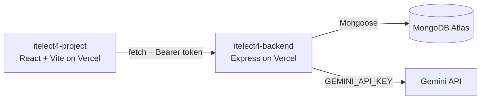

# ITELECT4 Backend API

[](https://github.com/enzoowi/itelect4-backend/actions/workflows/ci.yml)

## Live Deployment

| | URL |
|---|---|
| **Backend API** | <https://itelect4-backend-omega.vercel.app/> |
| **Frontend** | <https://itelect4-project-lilac.vercel.app/> |

## Architecture




## API Endpoints

### Health
| Method | Route | Auth | Description |
|---|---|---|---|
| GET | `/api/health` | No | Check server and DB status |

### Auth
| Method | Route | Auth | Description |
|---|---|---|---|
| POST | `/api/auth/register` | No | Register a new user |
| POST | `/api/auth/login` | No | Login and receive a JWT token |

### Courses (Reference Data)
| Method | Route | Auth | Description |
|---|---|---|---|
| GET | `/api/courses` | No | List all courses |
| GET | `/api/courses/:code` | No | Get a single course by code |

### Categories (Reference Data)
| Method | Route | Auth | Description |
|---|---|---|---|
| GET | `/api/categories` | No | List all job categories |
| GET | `/api/categories/:code` | No | Get a single category by code |

### Jobs
| Method | Route | Auth | Description |
|---|---|---|---|
| GET | `/api/jobs` | JWT | List jobs belonging to the authenticated user |
| GET | `/api/jobs/:id` | JWT | Get a single job by ID |
| POST | `/api/jobs` | JWT | Create a new job |
| PATCH | `/api/jobs/:id` | JWT | Update a job |
| DELETE | `/api/jobs/:id` | JWT | Delete a job |

### AI Review (Gemini)
| Method | Route | Auth | Description |
|---|---|---|---|
| POST | `/api/ai` | JWT | Review a project or job post description via Gemini AI |

## How to Install and Run

Copy the environment template and fill in your values:
```bash
cp .env.example .env
```

Install dependencies:
```bash
npm install
```

Seed the database (run once):
```bash
npm run seed
```

Start the development server:
```bash
npm run dev
```

## Environment Variables

| Variable | Description |
|---|---|
| `MONGODB_URI` | MongoDB Atlas connection string |
| `JWT_SECRET` | Secret key for signing JWT tokens |
| `PORT` | Port number (default: 4000) |
| `CORS_ORIGIN` | Allowed frontend origin(s), comma-separated |
| `GEMINI_API_KEY` | Google Gemini API key (server-side only) |
